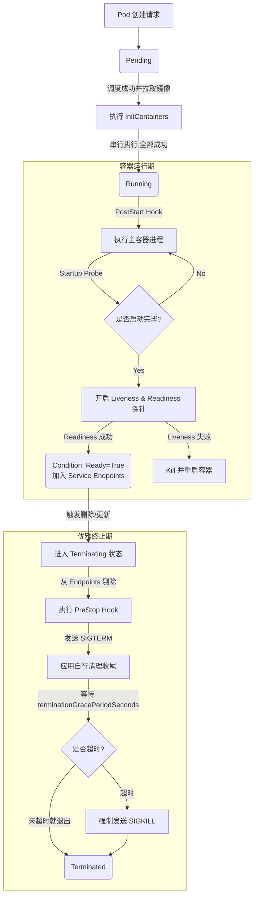

# 06 - 核心业务流程

前面五章介绍了 K8s 的各个组件和资源，本章将它们串联起来，理解完整的业务流程。

---

## 6.1 Pod 创建全流程

当用户执行 `kubectl apply` 创建一个 Deployment 时，从请求到容器运行经历以下步骤：

```
用户 kubectl apply
       │
       ▼
┌─ kube-apiserver ─────────────────────────────────┐
│  1. 认证（Authentication）                        │
│  2. 鉴权（Authorization / RBAC）                  │
│  3. Mutating Admission（注入 sidecar 等）          │
│  4. Schema 校验                                   │
│  5. Validating Admission（策略校验）               │
│  6. 写入 etcd                                     │
└──────────────┬───────────────────────────────────┘
               │
               ▼
┌─ Deployment Controller ─────────────────────────┐
│  7. 检测到新 Deployment                           │
│  8. 创建 ReplicaSet                               │
│  9. ReplicaSet 创建 Pod（写入 etcd，nodeName 为空）│
└──────────────┬───────────────────────────────────┘
               │
               ▼
┌─ kube-scheduler ────────────────────────────────┐
│  10. 发现未绑定节点的 Pod（nodeName 为空）         │
│  11. Filter：排除不满足约束的 Node                  │
│  12. Score：对候选 Node 打分                       │
│  13. Bind：将 Pod 绑定到最优 Node（写入 etcd）     │
└──────────────┬───────────────────────────────────┘
               │
               ▼
┌─ kubelet（目标 Node）───────────────────────────┐
│  14. Watch 发现调度到本节点的 Pod                  │
│  15. 调用 CRI 创建 Pod Sandbox（Pause 容器）       │
│  16. 拉取容器镜像（ImageService.PullImage）        │
│  17. 启动 Init Containers（依次运行到完成）        │
│  18. 启动主容器（RuntimeService.CreateContainer）  │
│  19. 挂载 Volume（ConfigMap/Secret/PVC）           │
│  20. 注入环境变量                                  │
│  21. 启动容器（RuntimeService.StartContainer）     │
│  22. 开始探针检测（Startup → Liveness → Readiness）│
│  23. 向 apiserver 汇报 Pod 状态                    │
└──────────────────────────────────────────────────┘
```

### 关键节点详解

**Admission Controller 阶段（步骤 3-5）：**

```
Mutating Admission（可修改请求）
  → ServiceAccount 自动注入
  → Sidecar 注入（如 Istio envoy）
  → 默认 StorageClass 注入
  → Pod Tolerations 注入

Schema Validation（校验资源格式）

Validating Admission（只读校验，不可修改）
  → PodSecurityPolicy / PodSecurity
  → ResourceQuota 检查
  → LimitRange 检查
  → 自定义 Webhook（OPA/Gatekeeper）
```

**调度决策（步骤 10-13）：**

```
Filter 阶段（硬性约束，排除不合格 Node）:
  - NodeSelector 匹配？
  - NodeAffinity 满足？
  - Taint/Toleration 匹配？
  - 资源充足？(CPU/Memory/存储)
  - 端口未冲突？
  - PVC 可绑定？

Score 阶段（软性偏好，候选 Node 评分）:
  - 资源均衡度（避免 Node 资源倾斜）
  - NodeAffinity 偏好加分
  - Pod 反亲和加分（分散部署）
  - 数据本地性加分
  - 自定义打分插件
```
---

## 6.1a 深入剖析：Pod 内部生命周期与状态流转

上一节我们从 K8s 全局组件的角度看了 Pod 是怎么被创建的。现在我们**将视角切换到 Pod 自身**，看看它从被分配到节点，到运行，再到销毁的整个微观状态流转。

一个 Pod 在 K8s 中的状态判定，实际上是由宏观的 **Phase (阶段)**、微观的 **ContainerState (容器状态)** 以及具体的 **Conditions (探针状况)** 三个维度共同拼凑出来的。

### 1. 宏观：Pod Phase (Pod 阶段)
这是你在 `kubectl get pods` 时最常看到的大状态：
* **Pending (挂起)**：Pod 已经被 K8s 接受，但还在等调度，或者在等下载镜像。
* **Running (运行中)**：Pod 已经绑定到 Node，且**至少有一个核心容器**正在运行、正在启动或正在重启。*(注意：Running 不代表你的服务可用，只代表进程跑起来了！)*
* **Succeeded (成功)**：所有容器都已成功终止，且不会再重启（通常是 Job/CronJob 跑完了）。
* **Failed (失败)**：所有容器都已终止，且至少有一个容器是因为失败（非 0 状态码）而终止的。
* **Unknown (未知)**：APIServer 无法获取 Pod 状态（通常是 Node 失联了）。

### 2. 微观：Container State (容器内部状态)
Pod 的 Phase 是由其内部每个容器的 State 决定的。容器虽然只有三种真实状态（Waiting, Running, Terminated），但 K8s 会附带一个 `Reason`（原因）字段。**我们在排错时经常看到的那些“状态”，其实都是 Reason！**

* **Waiting (等待)**：容器没有在运行。常见 Reason 包括：
  * `ContainerCreating`：正在挂载存储卷、拉取镜像。
  * `ImagePullBackOff` / `ErrImagePull`：镜像拉取失败（如名称写错、没配置 Secret）。K8s 正在按指数退避策略重试（BackOff）。
  * `CrashLoopBackOff`：最著名的报错。容器启动了，但主进程立刻崩溃退出（非 0 状态码），kubelet 会重启它；又崩溃，又重启，最终陷入退避循环。
* **Running (运行中)**：容器的主进程正在运行，没有报错退出。
* **Terminated (已终止)**：容器运行结束。常见 Reason 包括：
  * `Completed`：正常退出（状态码 0）。
  * `OOMKilled`：超出了内存 Limit，被宿主机内核强制 Kill（状态码 137）。
  * `Error`：因其他原因异常退出（如状态码 1/255 等）。

### 3. 里程碑：Pod Conditions (Pod 状况) & 探针辨析
这是决定 Pod 是否真的“准备好接客”的关键。Pod 有一个 `Conditions` 数组，就像它的体检报告，包含：`PodScheduled`, `Initialized`, `ContainersReady`, `Ready`。

> **💡 深度辨析：Container State 和 Pod Conditions 的本质区别**
> 很多初学者分不清两者。一句话概括：
> * **Container State 反映的是“物理现实”**：进程到底死没死？
> * **Pod Condition 反映的是“业务逻辑”**：应用到底能不能用？
> 
> **经典场景**：一个 Java SpringBoot 容器，主进程已经启动了（此时 `Container State = Running`），但是由于 Spring 框架需要 30 秒来初始化依赖注入和连数据库，在这个期间，Readiness Probe 会一直失败，导致 `Pod Condition (Ready) = False`。
> 结论：虽然进程是活的 (Running)，但它还没准备好接客 (Not Ready)，所以 K8s 依然不会把流量放给它。
> 
> **实战输出对比**：
> 这个 Java 慢启动的例子，如果你敲命令，会看到这样违背直觉的画面：
> ```bash
> # 1. kubectl get pod 看到的是汇总信息
> $ kubectl get pod my-java-app
> NAME          READY   STATUS    RESTARTS   AGE
> my-java-app   0/1     Running   0          15s
> # 👆 发现了吗？STATUS 是 Running (阶段/状态)，但 READY 是 0/1 (Condition 未就绪)
> 
> # 2. kubectl describe pod 看到底层细节
> $ kubectl describe pod my-java-app
> ...
> Conditions:
>   Type              Status
>   Initialized       True 
>   Ready             False   <-- 业务没就绪
>   ContainersReady   False 
>   PodScheduled      True 
> ...
> Containers:
>   my-java-container:
>     State:          Running <-- 物理进程是活的
>       Started:      Wed, 01 Jan 2026 10:00:00 +0800
>     Ready:          False
> ```

**这 4 项 Conditions 是怎么变成 True 的？这就引出了探针 (Probes)：**
* **Startup Probe (启动探针)**：专治“慢启动”应用。在它成功前，其他探针全部被挂起禁用。
* **Liveness Probe (存活探针)**：判断进程是否“假死”。如果失败，kubelet 会**杀掉容器并重启它**（从而可能引发 `CrashLoopBackOff`）。
* **Readiness Probe (就绪探针)**：判断应用是否“能接客”。如果失败，kubelet 会**把该 Pod 从 Service 的 Endpoints 列表中剔除**，从而改变 `Ready=False` 的 Condition，**但绝不会杀掉容器！**

### 4. Pod 的完整生命周期流水线

让我们把这些概念串成一条完整的时间线：



**防坑重点：优雅终止（Graceful Shutdown）为什么这么重要？**
在微服务场景下，如果你没有配置 `preStop` hook，或者你的代码忽略了 `SIGTERM` 信号，当 Pod 被删除时，K8s 会直接在几秒内切断网络并强制 `SIGKILL` 杀掉进程。这会导致那些正在处理中、还没返回结果的用户请求全部报 502/504 错误。合理的做法是捕获 `SIGTERM`，停止接收新请求，并利用这 30 秒默认的宽限期把手里现有的活儿干完再退出。

---

## 6.1b 深入剖析：资源阈值与驱逐（Eviction）

6.1a 讲的是 Pod「正常」的一生。但 Pod 还有一种非正常的结局：**节点资源快耗尽时，被 kubelet 主动踢掉**，这就是节点压力驱逐（Node-pressure Eviction）。

> **先辟谣**：K8s 里叫「驱逐」的机制有好几种（kubelet 资源驱逐、`kubectl drain`、污点驱逐、调度抢占），触发方和规则完全不同。本节主要讲 **kubelet 资源驱逐**，其余几种放在本节末尾对比。

### 1. 驱逐信号：kubelet 盯着什么

| 信号 | 含义 | 越线后的节点 Condition |
| :--- | :--- | :--- |
| `memory.available` | 节点可用内存 | `MemoryPressure` |
| `nodefs.available` / `nodefs.inodesFree` | kubelet 根目录（`/var/lib/kubelet`）所在磁盘的剩余空间和 inode | `DiskPressure` |
| `imagefs.available` / `imagefs.inodesFree` | 容器运行时存放镜像和可写层的磁盘 | `DiskPressure` |
| `pid.available` | 剩余可用的进程号 | `PIDPressure` |

> **防坑**：`memory.available` 不是 `free -m` 里的 free，而是 `节点容量 - workingSet`（workingSet = 已用内存 - 非活跃文件缓存）。所以 `free` 看着还有不少空闲时，节点照样可能触发驱逐。

### 2. 阈值：硬阈值和软阈值

| 类型 | 参数 | 越线后的行为 | Pod 宽限期 |
| :--- | :--- | :--- | :--- |
| **硬阈值** | `evictionHard` | **立即驱逐** | **0 秒**，直接 kill，不理会 `terminationGracePeriodSeconds` |
| **软阈值** | `evictionSoft` + `evictionSoftGracePeriod` | 持续越线满 grace period 才驱逐，短暂毛刺不会触发 | `min(Pod 的 terminationGracePeriodSeconds, evictionMaxPodGracePeriod)` |

Linux 下 `evictionHard` 的默认值：

```
memory.available  < 100Mi
nodefs.available  < 10%
imagefs.available < 15%
nodefs.inodesFree < 5%
```

软阈值**默认没有配置**，需要自己加。常见做法是软阈值比硬阈值宽一些，先给 Pod 优雅退出的机会，硬阈值作为兜底。

**三个辅助参数：**

| 参数 | 作用 | 解决的问题 |
| :--- | :--- | :--- |
| `evictionMinimumReclaim` | 每次驱逐至少额外回收这么多资源 | 避免刚降到线下又马上越线，导致反复驱逐 |
| `evictionPressureTransitionPeriod`（默认 5m） | 压力解除后，Condition 要等这么久才恢复为 False | 避免节点状态在 True/False 之间来回跳 |
| `kubeReserved` / `systemReserved` | 给 kubelet、容器运行时和系统进程预留资源 | 防止 Pod 把系统进程挤死 |

**阈值与 Allocatable 的关系（高频考点）：**

```
Allocatable = Capacity - kubeReserved - systemReserved - evictionHard
```

调度器只按 **Allocatable** 判断 requests 能不能放下。`kubectl describe node` 里 `Capacity` 和 `Allocatable` 两栏的差值，就是上面这些预留加上硬阈值。

### 3. 实际执行流程

```
kubelet 驱逐管理器周期巡检（默认约 10s 一轮；内存信号还可以由内核 memcg 通知实时触发）
   │
   ▼
[1] 采集各信号当前值，与硬/软阈值比较
   │   软阈值越线：开始计时，未满 grace period 时只记录，不处理
   ▼
[2] 确认越线 → 更新节点 Condition（如 MemoryPressure=True）
   │   → 节点被自动打上污点 node.kubernetes.io/memory-pressure:NoSchedule
   │   → 调度器不再往这台节点放新 Pod（DaemonSet 默认容忍该污点），先止血
   ▼
[3] 先回收节点级资源（只针对磁盘压力）
   │   nodefs 压力 → 清理已退出的容器和 Pod
   │   imagefs 压力 → 删除未被使用的镜像
   │   回收后已低于阈值 → 结束，一个 Pod 都不驱逐
   ▼
[4] 仍然越线 → 给节点上的 Pod 排序，每轮只驱逐 1 个
   │   驱逐 → 下一轮重新评估 → 直到低于「阈值 + minimumReclaim」
   ▼
[5] 被驱逐的 Pod：Phase=Failed，Reason=Evicted
   │   Pod 对象本身不会自动删除（残留在集群里）
   │   Deployment/ReplicaSet 发现副本不足 → 创建新 Pod，由调度器放到其他节点
   ▼
[6] 压力解除并持续 evictionPressureTransitionPeriod（5m）
       → Condition 恢复为 False，污点移除，节点重新接收调度
```

### 4. 谁先被驱逐：排序规则

以内存为例，kubelet 按以下三个条件依次比较：

1. **使用量是否超过 requests**：超过的排在前面。
2. **Pod Priority（PriorityClass）**：优先级低的排在前面。
3. **超出 requests 的量**：超得越多越靠前。

换算成 QoS 等级，实际效果大致是：

| 驱逐顺序 | Pod 类型 | 原因 |
| :--- | :--- | :--- |
| 最先 | **BestEffort**（未设置 requests/limits） | requests 为 0，任何使用量都算「超出」 |
| 其次 | **Burstable** 且使用量超过 requests | 超出越多越危险 |
| 最后 | **Guaranteed**，以及使用量低于 requests 的 Burstable | 只有系统进程挤占资源时才会轮到它们 |

> 磁盘压力的排序逻辑相同，比较的是 `ephemeral-storage` 使用量与 requests。这也是建议给 Pod 设置 `ephemeral-storage` requests/limits 的原因：日志狂写的 Pod 会被优先清理，而不是随机误伤。

### 5. 重点辨析：驱逐、容器 OOMKilled、节点 OOM

| 场景 | 触发方 | 触发条件 | 结果 | 在哪里看到 |
| :--- | :--- | :--- | :--- | :--- |
| **节点压力驱逐** | kubelet（用户态） | 节点整体资源低于驱逐阈值 | 整个 Pod 被终止，**不会原地重启**，由控制器在其他节点重建 | `kubectl get pod` 中 STATUS 显示 `Evicted` |
| **容器 OOMKilled** | 内核 cgroup | **单个容器**的内存超过自己的 `limits.memory` | 只杀这个容器，按 restartPolicy **原地重启**，反复发生会进入 `CrashLoopBackOff` | describe 中 `Last State: Terminated, Reason: OOMKilled` |
| **节点级 OOM Killer** | 内核 | 内存涨得太快，kubelet 来不及驱逐，节点内存真正耗尽 | 内核按 `oom_score_adj` 挑进程杀 | `dmesg -T \| grep -i oom` 或 `journalctl -k` |

节点级 OOM 时，内核依据的 `oom_score_adj` 也和 QoS 挂钩：Guaranteed 为 `-997`（几乎不会被杀），BestEffort 为 `1000`（最先被杀），Burstable 根据 requests 占节点内存的比例取 2~999 之间的值。

**结论**：kubelet 驱逐是**第一道防线**（主动、有序、按优先级），内核 OOM Killer 是**最后一道防线**（被动、粗暴，可能误杀 kubelet 或容器运行时等关键进程）。硬阈值设得太小，就等于把节点的命运交给内核 OOM。

### 6. 实战：查询当前驱逐策略

kubelet 的驱逐参数有两个来源：**配置文件**（`--config` 指定的 KubeletConfiguration）和**命令行参数**（`--eviction-hard=...`，已不推荐使用）。**两者同时存在时，命令行参数优先**，所以排查时两边都要看。

```bash
# ① 最权威：直接问 kubelet「当前实际生效」的配置（不受文件和参数来源干扰）
kubectl get --raw "/api/v1/nodes/<node>/proxy/configz" | jq '.kubeletconfig | {
  evictionHard, evictionSoft, evictionSoftGracePeriod, evictionMaxPodGracePeriod,
  evictionMinimumReclaim, evictionPressureTransitionPeriod,
  kubeReserved, systemReserved, enforceNodeAllocatable }'

# ② 在节点上找配置文件路径，以及是否有命令行参数覆盖
ps -ef | grep [k]ubelet | tr ' ' '\n' | grep -E "^--(config|eviction|kube-reserved|system-reserved)"
systemctl cat kubelet                         # 查看 systemd unit 及其 drop-in
cat /var/lib/kubelet/kubeadm-flags.env        # kubeadm 部署的集群会把额外参数放在这里

# ③ 查看配置文件里的驱逐相关字段（kubeadm 默认路径；二进制部署以 ps 查到的 --config 为准）
grep -A6 -E "eviction|Reserved" /var/lib/kubelet/config.yaml

# ④ 查看阈值对 Allocatable 的实际影响
kubectl describe node <node> | grep -A7 -E "^Capacity|^Allocatable"
```

### 7. 实战：查询节点当前的资源压力

```bash
# 节点 Condition：MemoryPressure / DiskPressure / PIDPressure 是否为 True
kubectl describe node <node> | grep -A8 "Conditions:"
kubectl get node -o custom-columns='NAME:.metadata.name,MEM:.status.conditions[?(@.type=="MemoryPressure")].status,DISK:.status.conditions[?(@.type=="DiskPressure")].status,PID:.status.conditions[?(@.type=="PIDPressure")].status'

# 节点上是否已被打上压力污点
kubectl get node <node> -o jsonpath='{.spec.taints}' | jq

# kubelet 眼中的实时信号值（驱逐判断就是拿这些数和阈值比）
kubectl get --raw "/api/v1/nodes/<node>/proxy/stats/summary" | jq '{
  memAvailableMi: (.node.memory.availableBytes / 1048576 | floor),
  workingSetMi:   (.node.memory.workingSetBytes / 1048576 | floor),
  nodefsAvailGi:  (.node.fs.availableBytes / 1073741824 | floor),
  imagefsAvailGi: (.node.runtime.imageFs.availableBytes / 1073741824 | floor) }'

# 驱逐事件与被驱逐的 Pod
kubectl get events -A --field-selector reason=Evicted --sort-by=.lastTimestamp
kubectl get pod -A --field-selector=status.phase=Failed | grep Evicted
kubectl describe pod <pod> | grep -E "Status:|Reason:|Message:"
#   Status:   Failed
#   Reason:   Evicted
#   Message:  The node was low on resource: memory. Threshold quantity: 500Mi, available: 412Mi. ...

# 节点上 kubelet 的驱逐日志
journalctl -u kubelet --since "1 hour ago" | grep -iE "eviction|evict"

# 清理残留的 Evicted Pod 对象
kubectl delete pod -A --field-selector=status.phase=Failed
```

### 8. 实战：配置软/硬驱逐策略

**方式一：修改 kubelet 配置文件（推荐）**

```yaml
# /var/lib/kubelet/config.yaml（二进制部署以 --config 指定的路径为准）
apiVersion: kubelet.config.k8s.io/v1beta1
kind: KubeletConfiguration
# ---------- 硬阈值：越线立即驱逐，宽限期为 0 ----------
evictionHard:
  memory.available: "500Mi"
  nodefs.available: "10%"
  nodefs.inodesFree: "5%"
  imagefs.available: "15%"
  pid.available: "5%"
# ---------- 软阈值：持续越线一段时间才驱逐 ----------
evictionSoft:
  memory.available: "1Gi"
  nodefs.available: "15%"
evictionSoftGracePeriod:          # 每个软阈值都必须配置对应的 grace period，否则 kubelet 启动报错
  memory.available: "1m30s"
  nodefs.available: "2m"
evictionMaxPodGracePeriod: 60     # 软驱逐时 Pod 最多可优雅退出 60 秒
# ---------- 防止反复横跳 ----------
evictionMinimumReclaim:
  memory.available: "200Mi"
  nodefs.available: "1Gi"
evictionPressureTransitionPeriod: 5m
# ---------- 资源预留 ----------
kubeReserved:
  cpu: "500m"
  memory: "1Gi"
  ephemeral-storage: "1Gi"
systemReserved:
  cpu: "500m"
  memory: "1Gi"
```

```bash
# 使配置生效（逐台节点执行，建议先 drain 再重启，避免误伤业务）
kubectl drain <node> --ignore-daemonsets --delete-emptydir-data
systemctl restart kubelet
systemctl status kubelet --no-pager          # 确认没有因为配置错误起不来
journalctl -u kubelet -n 50 --no-pager | grep -iE "error|evict"
kubectl uncordon <node>

# 验证：再查一次 configz，确认新值已生效
kubectl get --raw "/api/v1/nodes/<node>/proxy/configz" | jq '.kubeletconfig.evictionHard'
```

**方式二：命令行参数（老式写法，了解即可）**

```bash
# kubeadm 集群：写在 /var/lib/kubelet/kubeadm-flags.env
KUBELET_KUBEADM_ARGS="... --eviction-hard=memory.available<500Mi,nodefs.available<10% \
  --eviction-soft=memory.available<1Gi --eviction-soft-grace-period=memory.available=1m30s"
```

**方式三：kubeadm 集群批量下发**

```bash
# kubeadm 把集群级 kubelet 配置存放在这个 ConfigMap 中
kubectl -n kube-system edit cm kubelet-config
# 注意：修改 ConfigMap 不会自动作用到已有节点！需要在每台节点上执行：
kubeadm upgrade node phase kubelet-config && systemctl restart kubelet
```

> **三个高频大坑：**
> 1. **只写一部分 `evictionHard` 会把其他项清零**：一旦自定义了 `evictionHard`，没写到的信号**不会**继承默认值，而是被置为 0（等于关闭该信号的驱逐）。比如只写了 `memory.available`，磁盘驱逐就失效了。所以要把四个默认信号全部写上。
> 2. **软阈值必须配对 grace period**：配了 `evictionSoft` 却漏了对应的 `evictionSoftGracePeriod`，kubelet 会直接启动失败。
> 3. **`kubeReserved` 默认只影响 Allocatable 的计算，不做硬限制**：要真正用 cgroup 把 kubelet 和系统进程「圈」起来，还需要在 `enforceNodeAllocatable` 中加入 `kube-reserved` / `system-reserved`，并配置 `kubeReservedCgroup` / `systemReservedCgroup`。配置不当可能把 kubelet 自己限死，生产上要谨慎。

### 9. 实战：在测试环境中观察一次驱逐

```bash
# 在目标节点上起一个 BestEffort 的内存消耗 Pod（不设 requests/limits，最先被驱逐）
kubectl run mem-hog --image=polinux/stress --restart=Never \
  --overrides='{"spec":{"nodeName":"<node>"}}' \
  -- stress --vm 1 --vm-bytes 3G --vm-hang 0

# 另开终端观察：节点 Condition 变化 → Pod 变为 Evicted
kubectl get pod mem-hog -w
kubectl describe node <node> | grep -A8 "Conditions:"
kubectl get events --field-selector involvedObject.name=mem-hog
```

> `--vm-bytes` 需要按节点剩余内存调整：要让可用内存跌破硬阈值，但又不能涨得太猛。涨得太快时，可能 kubelet 还没来得及驱逐，内核 OOM 就先动手了（此时看到的是 `OOMKilled` 而不是 `Evicted`，这正好印证了第 5 小节的辨析）。

### 10. 其他几种「驱逐」对比

| 类型 | 触发方 | 逻辑 | 是否遵守 PDB |
| :--- | :--- | :--- | :--- |
| **节点压力驱逐** | kubelet | 本节前面讲的内容 | **不遵守**（资源都要耗尽了，顾不上） |
| **API 发起的驱逐**（`kubectl drain`） | 用户/运维工具 | 先 cordon 节点，再对每个 Pod 调用 Eviction API。APIServer 检查 PDB，违反时返回 429，drain 会不断重试 | **遵守** |
| **污点驱逐**（NoExecute） | controller-manager | 节点 NotReady/失联时自动加上 `NoExecute` 污点。Pod 默认带 `tolerationSeconds: 300`，**5 分钟后被删除并重建** | 不遵守 |
| **调度抢占**（Preemption） | kube-scheduler | 高优先级 Pod 没地方放时，挤掉低优先级 Pod | 尽量遵守，但不保证 |

> **常见问题**：「节点宕机后，为什么 Pod 要过 5 分钟左右才在别处重建？」原因就是污点驱逐默认的 `tolerationSeconds: 300`。对恢复速度敏感的业务，可以在 Pod 上显式声明 `node.kubernetes.io/not-ready` 和 `node.kubernetes.io/unreachable` 的 toleration，把时间调短。

---
## 6.2 服务发现流程

Pod 如何找到并访问其他服务？

```
┌─────────────────────────────────────────────────────────┐
│                      Service 创建                        │
│                                                         │
│  1. 用户创建 Service（selector: app=webapp）              │
│  2. Endpoints Controller 监听，找到匹配的 Pod             │
│  3. 创建 Endpoints 对象，记录 Pod IP:Port                 │
│  4. kube-proxy 监听 Service/Endpoints 变化                │
│  5. 在每个 Node 上写入 iptables/IPVS 规则                 │
│  6. CoreDNS 为 Service 创建 DNS A 记录                    │
└─────────────────────────────────────────────────────────┘

┌─────────────────────────────────────────────────────────┐
│                   请求访问流程                            │
│                                                         │
│  Pod A 发起请求：                                        │
│    curl http://webapp-svc:80                             │
│         │                                               │
│         ▼                                               │
│  ① DNS 解析（CoreDNS）                                   │
│    webapp-svc.default.svc → 10.96.0.100                 │
│         │                                               │
│         ▼                                               │
│  ② 请求发到 ClusterIP（虚拟 IP，不绑定网卡）              │
│         │                                               │
│         ▼                                               │
│  ③ iptables/IPVS DNAT（由 kube-proxy 维护）              │
│    10.96.0.100:80 → 10.244.1.5:8080 (Pod B)             │
│                  → 10.244.2.8:8080 (Pod C)              │
│                  → 10.244.3.2:8080 (Pod D)              │
│         │                                               │
│         ▼                                               │
│  ④ 流量直达后端 Pod（无中间代理）                         │
└─────────────────────────────────────────────────────────┘
```

> **🔥 核心防坑提示：负载均衡到底在哪发生？**
> 很多开发者误以为请求 Service 是通过 DNS 轮询到不同 Pod 实现的。请注意：
> - **① 阶段（CoreDNS）**：永远只返回固定唯一的虚拟 ClusterIP，**绝对不负责负载均衡**。
> - **③ 阶段（内核劫持）**：真正的负载均衡是在**发起方所在节点的 Linux 内核中**发生的。内核依据 `kube-proxy` 写好的规则（如 iptables 的随机概率，或 IPVS 算法），将数据包的目标 IP 强行改写为真正的 Pod IP。内核无需记录上一次分配给了谁，纯靠概率计算实现完美分发。

### Session Affinity（会话亲和）

```yaml
spec:
  sessionAffinity: ClientIP        # 同一客户端 IP 始终访问同一 Pod
  sessionAffinityConfig:
    clientIP:
      timeoutSeconds: 3600
```

### 服务发现方式对比

| 方式 | 说明 | 适用场景 |
|------|------|---------|
| **环境变量** | `WEBAPP_SVC_SERVICE_HOST=10.96.0.100` | 简单场景，Pod 启动后 Service 不变 |
| **DNS（推荐）** | `webapp-svc.default.svc.cluster.local` | 通用场景，动态解析 |

环境变量在 Pod 创建时注入，如果 Service 在 Pod 之后创建则环境变量不存在。DNS 无此问题。

---

## 6.3 滚动更新流程

Deployment 的滚动更新是 K8s 最核心的发布策略，保证服务在更新过程中不中断。

### 完整流程

```
初始状态 (replicas=3, image=v1):
  RS-v1: [Pod-1] [Pod-2] [Pod-3]        ← 处理所有流量

用户更新 image 为 v2:
  Deployment Controller 介入

策略: maxSurge=1, maxUnavailable=0
  → 总数上限 3+1=4, 可用下限 3

Step 1: 创建 RS-v2，启动 1 个 v2 Pod
  RS-v1: [Pod-1] [Pod-2] [Pod-3]
  RS-v2: [Pod-4(v2)] (启动中)

Step 2: Pod-4 Readiness Probe 通过，加入 Service Endpoints
  RS-v1: [Pod-1] [Pod-2] [Pod-3]
  RS-v2: [Pod-4(v2)] ✓

Step 3: 缩减 RS-v1（总数不超过 4，可用不低于 3）
  RS-v1: [Pod-1] [Pod-2]                 ← Pod-3 被终止
  RS-v2: [Pod-4(v2)] ✓  [Pod-5(v2)] (启动中)

Step 4: 继续滚动...
  RS-v1: [Pod-1]
  RS-v2: [Pod-4] ✓ [Pod-5] ✓ [Pod-6(v2)] (启动中)

Step 5: 更新完成
  RS-v1: (replicas=0, 保留 RS 对象用于回滚)
  RS-v2: [Pod-4] ✓ [Pod-5] ✓ [Pod-6] ✓
```

### 关键配置

```yaml
strategy:
  type: RollingUpdate
  rollingUpdate:
    maxSurge: 25%            # 最多多出 25% 的 Pod（向上取整）
    maxUnavailable: 25%      # 最多允许 25% 不可用（向下取整）
```

**不同策略对比：**

| 配置 | 效果 | 适用场景 |
|------|------|---------|
| maxSurge=1, maxUnavailable=0 | 零停机，速度慢 | 关键服务 |
| maxSurge=25%, maxUnavailable=25% | 平衡速度与可用性 | 通用场景 |
| maxSurge=0, maxUnavailable=1 | 先删后建，有短暂中断 | 资源受限 |

### Pod 终止流程

```
Pod 被标记为终止
  │
  ├─ 1. 从 Service Endpoints 移除（停止接收新流量）
  │
  ├─ 2. preStop Hook 执行（清理、连接排空）
  │      - HTTP 回调或 Exec 命令
  │      - 例如：从负载均衡器注销
  │
  ├─ 3. 发送 SIGTERM 信号
  │
  ├─ 4. 等待 terminationGracePeriodSeconds（默认 30s）
  │      - 应用处理完现有请求后退出
  │      - 超时后发送 SIGKILL 强制终止
  │
  └─ 5. Pod 状态变为 Succeeded/Failed，kubelet 清理
```

### preStop Hook 示例

```yaml
containers:
- name: app
  image: myapp:1.0
  lifecycle:
    preStop:
      exec:
        command: ["/bin/sh", "-c", "sleep 15"]
        # 等待 15 秒确保 iptables 规则已更新
        # 避免终止过程中仍有新流量进入
```

---

## 6.4 弹性伸缩

K8s 提供三个层次的自动伸缩能力：

```
                   ┌──────────────────────────────────┐
                   │     Cluster Autoscaler           │
                   │     (节点级别)                    │
                   │     自动增减 Node 数量            │
                   └──────────┬───────────────────────┘
                              │ 资源不足时扩容节点
                              ▼
┌──────────────────────────────────────────────────────────┐
│                   Horizontal Pod Autoscaler (HPA)        │
│                   (Pod 数量级别)                          │
│                   根据指标自动增减 Pod 副本数              │
└──────────────────────────────────────────────────────────┘
                              │
                              ▼
┌──────────────────────────────────────────────────────────┐
│                   Vertical Pod Autoscaler (VPA)          │
│                   (Pod 资源级别)                          │
│                   自动调整单个 Pod 的 CPU/Memory 限制      │
└──────────────────────────────────────────────────────────┘
```

### HPA — 水平伸缩

```yaml
apiVersion: autoscaling/v2
kind: HorizontalPodAutoscaler
metadata:
  name: webapp-hpa
spec:
  scaleTargetRef:
    apiVersion: apps/v1
    kind: Deployment
    name: webapp
  minReplicas: 2
  maxReplicas: 20
  metrics:
  - type: Resource
    resource:
      name: cpu
      target:
        type: Utilization
        averageUtilization: 70     # CPU 使用率 > 70% 时扩容
  - type: Resource
    resource:
      name: memory
      target:
        type: Utilization
        averageUtilization: 80     # 内存使用率 > 80% 时扩容
  - type: Pods                    # 自定义指标
    pods:
      metric:
        name: http_requests_per_second
      target:
        type: AverageValue
        averageValue: "1000"       # 每 Pod QPS > 1000 时扩容
  behavior:                       # 伸缩行为控制
    scaleDown:
      stabilizationWindowSeconds: 300   # 缩容前稳定 5 分钟（防抖动）
      policies:
      - type: Pods
        value: 1                        # 每次最多缩 1 个
        periodSeconds: 60
    scaleUp:
      stabilizationWindowSeconds: 0     # 扩容立即执行
      policies:
      - type: Pods
        value: 4                        # 每次最多扩 4 个
        periodSeconds: 60
```

**HPA 算法：**

```
期望副本数 = ceil[当前副本数 × (当前指标值 / 目标指标值)]

例：当前 3 个 Pod，平均 CPU 85%，目标 70%
期望 = ceil[3 × (85/70)] = ceil[3.64] = 4 → 扩容到 4
```

**依赖组件：**

```
Metrics Server（必须）
  → 收集每个 Node/Pod 的 CPU/Memory 指标
  → HPA 每 15 秒查询一次

Prometheus Adapter（可选，自定义指标）
  → 将 Prometheus 指标转换为 K8s custom/external metrics
```

### VPA — 垂直伸缩

```yaml
apiVersion: autoscaling.k8s.io/v1
kind: VerticalPodAutoscaler
metadata:
  name: webapp-vpa
spec:
  targetRef:
    apiVersion: apps/v1
    kind: Deployment
    name: webapp
  updatePolicy:
    updateMode: "Auto"        # Auto | Initial | Off
    # Auto: 自动调整并重启 Pod
    # Initial: 只在 Pod 创建时设置
    # Off: 只推荐，不自动调整
  resourcePolicy:
    containerPolicies:
    - containerName: "*"
      minAllowed:
        cpu: "50m"
        memory: "64Mi"
      maxAllowed:
        cpu: "2"
        memory: "2Gi"
```

### Cluster Autoscaler — 集群伸缩

Cluster Autoscaler 根据 Pending Pod 自动扩容节点，根据资源利用率自动缩容节点。

```
扩容触发：
  Pod 无法调度（Pending）→ 没有 Node 满足资源需求
    → Cluster Autoscaler 向云厂商请求新 Node
    → 新 Node Ready → Pod 调度成功

缩容触发：
  Node 利用率 < 50% 持续 10 分钟
    → 检查该 Node 上的 Pod 能否迁移到其他 Node
    → 如果可以 → 驱逐 Pod → 删除 Node
```

### 三者配合

```
流量高峰：
  HPA 扩 Pod → Pod 数量增加
    → 资源不足 → Cluster Autoscaler 扩 Node
      → 新 Node Ready → Pending Pod 调度成功

流量低谷：
  HPA 缩 Pod → Pod 数量减少
    → Node 利用率下降 → Cluster Autoscaler 缩 Node
      → Pod 迁移到其他 Node → 删除空闲 Node

VPA 持续优化：
  监控实际资源使用 → 推荐合理的 requests/limits
    → 减少资源浪费，提升调度准确性
```

---

## 本章小结

| 流程 | 核心链路 | 关键组件 |
|------|---------|---------|
| Pod 创建 | kubectl → apiserver → etcd → scheduler → kubelet → 容器运行时 | 全链路协作 |
| 资源驱逐 | 信号越线 → 节点 Condition/污点 → 回收镜像/容器 → 按 QoS/优先级逐个驱逐 Pod | kubelet 驱逐管理器 |
| 服务发现 | DNS 解析 → ClusterIP → iptables/IPVS DNAT → 后端 Pod | CoreDNS, kube-proxy |
| 滚动更新 | 新 RS 扩容 → Readiness 通过 → 旧 RS 缩容 → 零停机 | Deployment Controller |
| 弹性伸缩 | HPA 调副本数, VPA 调资源量, CA 调节点数 | Metrics Server, Prometheus |

**上一章：[05-配置与存储](05-配置与存储.md)** | **下一章：[07-案例-Web应用部署](07-案例-Web应用部署.md)** →
